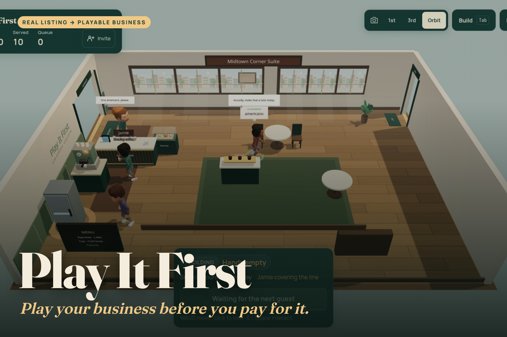
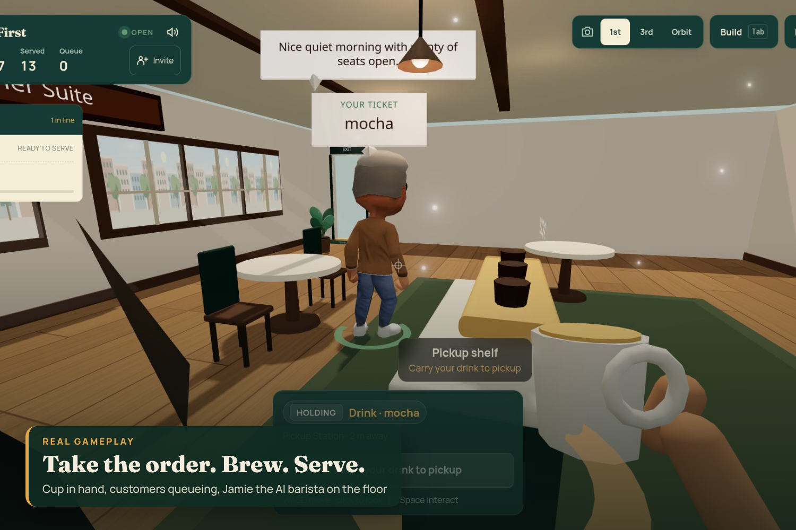
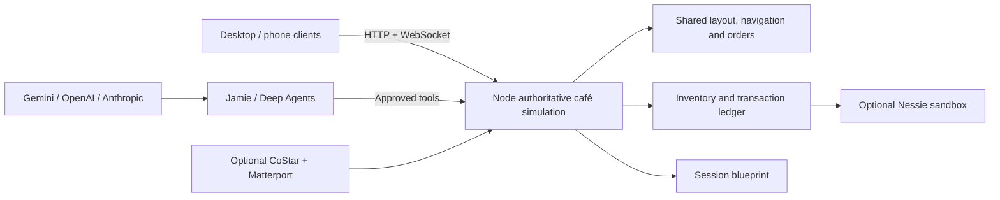

<div align="center">



# Play It First

### Play your business before you pay for it.

*A multiplayer business simulator that turns commercial properties into playable cafés. Design the space, run a soft opening with friends, and test business decisions before committing real capital.*

<p>
  
  
  
  
  
  
  
  
</p>

<sub>🏆 Winner: <b>Best Use of Nessie - Capital One</b> @ HackPrinceton Fall 2026</sub>

</div>

---

## The game

### Build your café
Choose a property, inspect its walkthrough and arrange the café. Build mode offers snapped placement, rotation, moving and removal with shared collision and route validation. A friend can keep serving while you edit; moving a counter changes the customers' routes.

The bundled practice properties are fictional. An authorized CoStar extract and matched Matterport capture can supply a real listing and measured floor plan. Real-property data and credentials are configured separately and are not included in the checkout.

### Work a shift together
Customers enter, queue and place orders. Take a ticket, walk to the espresso machine, brew, carry the cup and deliver it at pickup. Accepted actions update shared orders, stock and cash. QR invites and resume tokens bring friends into the same authoritative simulation.

### Make business decisions
Jamie, the café manager, inspects the room, proposes changes and executes an exact owner-approved action through LangChain Deep Agents. It reads the outcome from the simulation. Without a configured model, the game uses labeled local rules.

Capital One Nessie mirrors accepted transactions into a **sandbox** account and reconciles them with the game ledger. Optional Grok customer reactions add feedback; the launch blueprint exports the actual session's layout, receipts and operating assumptions. All money is simulated.

## Gameplay

<p align="center"></p>

## Controls

| Action | Desktop | Phone |
| --- | --- | --- |
| Move | WASD | Touch movement controls |
| Look | Mouse / camera controls | Drag to look |
| Take order, brew, serve | Context action with E / Space | On-screen action button |
| Build | Tab or Build menu | Build menu |
| Manage, invite, sound, help | Menu and HUD controls | Menu and HUD controls |

Start with **Play Demo** for a guided shift, or host a room and invite friends by QR. First-person, third-person and tabletop views are available. See the in-game help for camera-specific controls.

## Run locally

Use **Node.js 22** and npm. Sponsor credentials are optional for the practice café.

```sh
git clone https://github.com/farhanmir/PlayItFirst.git
cd PlayItFirst
npm ci --include=dev
npm run dev
```

Open **http://localhost:5173**. The same process serves the game, HTTP API and WebSocket connection. Copy [`.env.example`](.env.example) to an ignored `.env` only when configuring integrations. On PowerShell, use `Copy-Item .env.example .env`; `npm.cmd` works if the shell blocks `npm.ps1`.

For a local production run:

```sh
npm run build
npm start
```

Phones must reach the server's actual LAN or HTTPS origin; `localhost` on a phone refers to the phone. Production is configured for one existing Render service, with same-origin HTTP/WSS and proxy-aware QR links. [Deployment instructions](docs/DEPLOY.md).

## How it works



| Directory | Responsibility |
| --- | --- |
| `client/` | React, Vite, React Three Fiber scene, controls and optional management panels |
| `server/` | Node HTTP/WebSocket server, rooms, simulation, navigation, manager and provider adapters |
| `shared/` | TypeScript contracts, movement, placement and floor-plan validation |
| `data/` | Bundled fictional property fixtures |
| `public/` | Game assets, installation shell and offline notice |
| `scripts/` | Deployment, provider and private-property conversion checks |
| `docs/` | Deployment, integration setup and presentation images |

Rooms live in memory and reset on process restart. Installation support does not make multiplayer available offline. Timeline/rival comparisons are labeled heuristics; optional WebXR remains unverified on a headset.

## Integrations and configuration

| Integration | Configuration / limits |
| --- | --- |
| CoStar + Matterport | Authorized private extract and server-side Matterport credentials; preserve source and publication permissions |
| Jamie / Deep Agents | `GOOGLE_API_KEY` or `GEMINI_API_KEY`, `OPENAI_API_KEY`, or `ANTHROPIC_API_KEY`; provider precedence and optional model override in the environment example |
| Nessie | `NESSIE_KEY`, optional sandbox URL and owner activation code; game ledger remains authoritative |
| Grok customers | `XAI_API_KEY`; generic café counts only, scripted behavior without the key |
| Photon messaging / voice | Optional provisioned provider identities and owner pairing; implemented paths do not establish delivered messages or completed telephone calls |

Keep secrets server-side. Leave `ALLOW_SPONSOR_MODEL_CONTEXT`, `ALLOW_SPONSOR_BANK_CONTEXT` and `ALLOW_SPONSOR_PHONE_CONTEXT` false unless the relevant external processing is authorized. [Environment example](.env.example) · [Provider and deployment setup](docs/DEPLOY.md) · [Photon setup](docs/PHOTON_SETUP.md).

## Checks

```sh
npm test
npm run typecheck
npm run build
python -m unittest discover -s scripts -p 'test_*.py'
```

After starting a production build, run `node scripts/check-deployment.mjs http://127.0.0.1:5173`. This checks assets, HTTP, two WebSocket clients, layout sync and resume; it does not verify WebGL, phone hardware or live providers.
